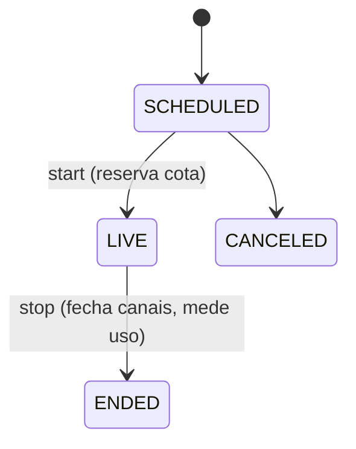
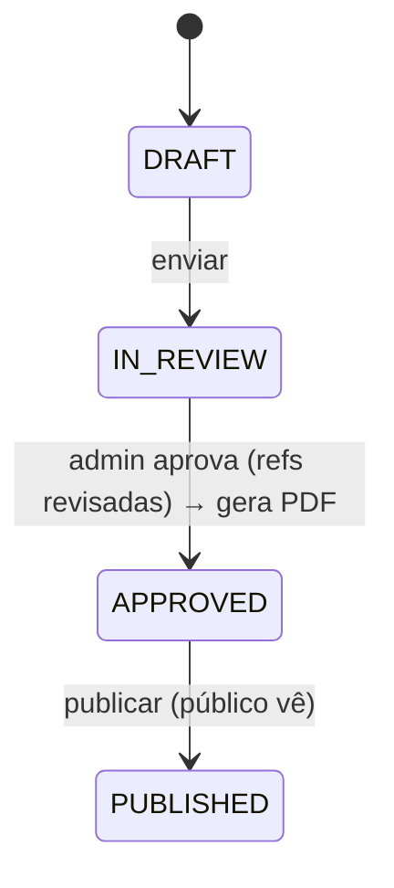

# Arquitetura

```mermaid
flowchart LR
  X32[Mesa Behringer X32] -->|USB| PC[PC Windows + utilitário de captura]
  PC -->|WSS /ingest (token efêmero)| API
  subgraph Servidor
    API[FastAPI] --> CM[ChannelManager<br/>1 canal por idioma]
    CM -->|failover por idioma| P1[Gemini - primário]
    CM --> P2[Azure - fallback]
    CM --> HUB[Hub pub/sub]
    API --> DB[(PostgreSQL + RLS)]
    HUB --> DB
  end
  HUB -->|WSS /live| L1[Ouvinte web]
  HUB --> L2[Ouvinte mobile]
  L1 -->|HTTPS| API
  ADM[Painel organizador / Super admin] -->|HTTPS + JWT| API
  STRIPE[Stripe] -->|webhook assinado| API
```

```mermaid
sequenceDiagram
  participant O as Ouvinte
  participant A as API
  participant C as ChannelManager
  O->>A: GET /public/join/{code} + POST /token
  O->>A: WS auth {token, lang, last_seq}
  A-->>O: replay (segmentos perdidos)
  A->>C: join(sessão, idioma) (+1 ouvinte)
  C-->>A: provedor traduz → write_segment
  A-->>O: segment (provisório → final)
  O->>A: fecha a aba
  A->>C: leave (-1); 0 ouvintes → desliga após carência
```




